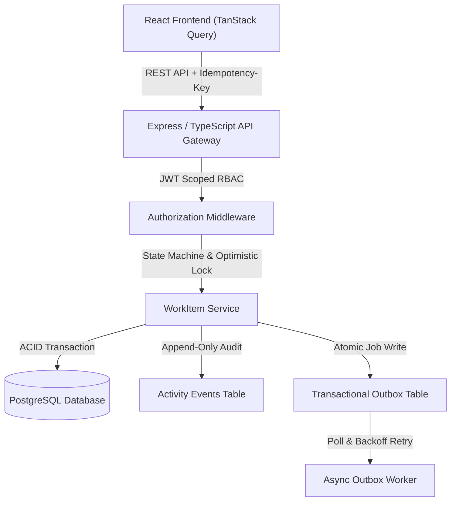

# Newtonite: Operations Under Pressure

An internal operations management platform engineered for cross-team work dispatch, triage, tracking, and resolution under intense operational load. Built with a focus on **correctness under concurrency**, **defensive server-side authorization**, and **transactional auditability**, this system guarantees reliable behavior when multiple operators contend for the same work items.

---

## Architecture Overview



---

## Key Engineering Highlights Beyond CRUD

1. **Atomic Concurrency-Safe Claiming:** Uses conditional SQL updates (`WHERE id = ? AND assigneeId IS NULL`) to guarantee that when multiple users attempt to claim an incident at the exact same millisecond, exactly one wins with `200 OK` while the loser immediately receives `409 Conflict`.
2. **Optimistic Locking for Stale Edits:** Work items feature a monotonic `version` counter checked on every mutation (`WHERE id = ? AND version = ?`). Stale edits are rejected with `409 Conflict`, returning the latest item representation for UI reconciliation.
3. **Idempotency Key Header Enforcement:** State-modifying requests accept an `Idempotency-Key` header with SHA256 payload verification. Duplicate submissions (network retries or rapid double-clicks) return cached deterministic responses without re-executing mutations.
4. **Server-Enforced State Machine & Lead Approval Gate:** Workflow transitions follow a strict directed graph (`OPEN` $\to$ `IN_PROGRESS` $\to$ `AWAITING_APPROVAL` $\to$ `RESOLVED` $\to$ `CLOSED`). Transitioning to `RESOLVED` requires a team `LEAD` or `ADMIN` role.
5. **Multi-Tenant Scoped RBAC:** Resource-level authorization guarantees users only query and modify items within their designated teams.
6. **Transactional Outbox Background Processing:** Notifications and external dispatch jobs are inserted in the **exact same database transaction** as item state changes, eliminating dual-write divergence.
7. **Scale-Aware Cursor Pagination:** Uses deterministic cursor indexing `(createdAt, id)` across 2,200+ seeded records for sub-10ms queries.

---

## Prerequisites

* **Docker & Docker Compose** (for containerized deployment), **OR**
* **Node.js (v18+)** and **PostgreSQL (v14+)** (for local development).

---

## Quickstart (One-Command Reviewer Setup)

To launch the full stack (PostgreSQL database, Backend API, Outbox Worker, and Frontend UI) with seeded data:

```bash
docker compose up --build
```

* **Frontend Dashboard:** [http://localhost:3000](http://localhost:3000)
* **Backend API:** [http://localhost:4000](http://localhost:4000)
* **Healthcheck:** [http://localhost:4000/health](http://localhost:4000/health)

---

## Local Development (Without Docker)

### 1. Database Setup
Ensure PostgreSQL is running locally on port 5432 with database `newtonite_ops`.

### 2. Backend Setup
```bash
cd backend
cp ../.env.example .env
npm install
npx prisma db push
npx tsx prisma/seed.ts
npm run dev
```

### 3. Frontend Setup
```bash
cd frontend
npm install
npm run dev
```
Open [http://localhost:3000](http://localhost:3000) in your browser.

---

## Running Automated Tests

A comprehensive integration test suite verifies concurrency races, optimistic lock mismatches, idempotency caching, state machine transitions, and cross-team authorization:

```bash
cd backend
npm test
```

### Test Coverage Highlights:
* `concurrency.test.ts`: Fires parallel simultaneous claims to prove single-winner semantics, and tests stale version rejection.
* `workflow_and_auth.test.ts`: Proves invalid state jumps fail with 400, non-Lead approval fails with 403, and cross-team snooping is blocked with 403.
* `idempotency_and_outbox.test.ts`: Verifies duplicate keys yield cached responses and outbox background worker processes queued jobs.

---

## Demo Credentials (Seeded Accounts)

All seeded demo accounts use the standard password: **`password123`**

| Role | Email | Team Scope | Key Capabilities |
| :--- | :--- | :--- | :--- |
| **Global Admin** | `admin@newtonite.internal` | All Teams | Unrestricted access across all operational teams |
| **Ops Lead** | `lead.ops@newtonite.internal` | Core Infrastructure | Can approve and resolve items in Core Ops |
| **Ops Member** | `member.ops@newtonite.internal` | Core Infrastructure | Can create, claim, and work items; cannot approve to Resolved |
| **Ops Viewer** | `viewer.ops@newtonite.internal` | Core Infrastructure | Read-only access to Core Ops queue |
| **Payments Lead** | `lead.payments@newtonite.internal` | Payments & Billing | Lead approval gate in Payments; blocked from Core Ops items |
| **Support Member** | `member.support@newtonite.internal` | Customer Escalations | Member in Support team; blocked from Payments items |

> **Pro-Tip for Evaluators:** The frontend features an interactive **Quick Role Switcher** toolbar at the top of the screen. You can switch between roles with a single click to test permissions live without logging in and out.

---

## Known Limitations

1. **Transactional Outbox Polling Interval:** The current outbox worker polls every 2 seconds. At ultra-high scale ($10,000+$ jobs/sec), polling PostgreSQL would introduce I/O overhead; migrating to PostgreSQL `LISTEN/NOTIFY` or Redis/BullMQ would reduce latency.
2. **Websocket Live Streaming:** Real-time synchronization currently relies on TanStack Query interval refetching and explicit user reload prompts on conflict rather than live WebSockets.
3. **Soft Deletion:** Items are currently closed rather than soft-deleted. Adding a `deletedAt` column would be required for strict legal data purging.

---

## Next Week Roadmap ("Next week I would...")

* **PostgreSQL LISTEN/NOTIFY Integration:** Trigger immediate outbox worker execution on transaction commit instead of fixed-interval polling.
* **Audit Trail Table Partitioning:** Partition `activity_events` by month to maintain fast indexing as historical events grow into millions of rows.
* **Read-Replica Routing:** Direct high-volume dashboard read queries and search queries to a PostgreSQL read replica, preserving primary write capacity for transactional state updates.
* **Granular Role Matrix Customization:** Allow team leads to define ad-hoc permission policies per incident severity tier.
